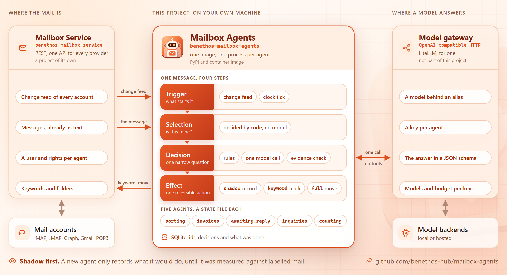

#  Mailbox Agents

[](https://github.com/benethos-hub/mailbox-agents/actions/workflows/ci.yml)
[](https://github.com/benethos-hub/mailbox-agents/actions/workflows/ci.yml)
[](https://github.com/benethos-hub/mailbox/blob/main/packages/mailbox-agents/LICENSE)
[](https://pypi.org/project/benethos-mailbox-agents/)

[](https://pypi.org/project/benethos-mailbox-agents/)
[](https://github.com/benethos-hub/mailbox-agents/pkgs/container/benethos-mailbox-agents)

[](https://github.com/sponsors/BeneODev)
[](https://paypal.me/BeneODev)

Small agents that work on a mailbox continuously. Each one looks at mail as
it arrives or leaves, decides one narrow question about it and takes one
reversible action: a keyword, or a move to a folder. The first ones sort
invoices, track sent mail that still waits for a reply, recognise project
inquiries and file the mail of listed senders into folders.

> **Status: alpha.** Built, and run on a test account of invented mail. On
> a real mailbox only an early version of `invoices` ran, in the stage
> `shadow`, and changed nothing. Names, settings and the state file may still change from one
> version to the next. The design is written down in
> [docs/mailbox-agents/CONCEPT.md](https://github.com/benethos-hub/mailbox/blob/main/docs/mailbox-agents/CONCEPT.md),
> and no agent acts on a real mailbox yet. Do not point it at a mailbox you
> care about.

## How it works

<picture>
  <source srcset="https://raw.githubusercontent.com/benethos-hub/mailbox/main/assets/mailbox-agents/architecture/architecture-dark.png" media="(prefers-color-scheme: dark)">
  
</picture>

- Mail is reached only through the REST API of the
  [mailbox service](https://github.com/benethos-hub/mailbox), with its
  Python client `benethos-mailbox-client`. An agent works only against a
  version of the service it was tested against, today 0.8 from 0.8.0 and
  0.9 from 0.9.0 and 0.10 from 0.10.0, and refuses any other. Which release works with which release of the
  service:
  [docs/mailbox-agents/COMPATIBILITY.md](https://github.com/benethos-hub/mailbox/blob/main/docs/mailbox-agents/COMPATIBILITY.md).
- A language model is reached only through an OpenAI-compatible gateway,
  with one call per message, a JSON schema for the answer and no tools.
- Everything else is deterministic code: which messages an agent looks at,
  what a rule says, whether a quote from the model is really in the mail,
  and which action follows.
- Every agent runs in a process of its own, with its own credentials and
  its own SQLite state file. The state file holds ids and decisions, never
  the text of a mail.
- A new agent starts in the stage `shadow`, where it only records what it
  would do. The stages `keyword` and `full` follow after it was measured
  against labelled mail.

## Install

The package is `benethos-mailbox-agents` on PyPI, for Python 3.11 or
newer:

```
uvx benethos-mailbox-agents --version
```

In operation each agent runs as a container of the image
`ghcr.io/benethos-hub/benethos-mailbox-agents`.
[containers/production](https://github.com/benethos-hub/mailbox/blob/main/containers/production/mailbox-agents/README.md)
holds the compose file and says how to set it up. Every setting is listed
in
[docs/mailbox-agents/concept/configuration.md](https://github.com/benethos-hub/mailbox/blob/main/docs/mailbox-agents/concept/configuration.md).

## Development

Needs [uv](https://docs.astral.sh/uv/) and a clone of the repository.

```
uv sync
uv run benethos-mailbox-agents --version
uv run pytest -q
```

The suite is offline. The live checks run against a mail server and a
mailbox service of their own with invented mail, see
[containers/live](https://github.com/benethos-hub/mailbox/blob/main/containers/live/mailbox-agents/README.md).

## Licence

MIT, see [LICENSE](https://github.com/benethos-hub/mailbox/blob/main/packages/mailbox-agents/LICENSE).
