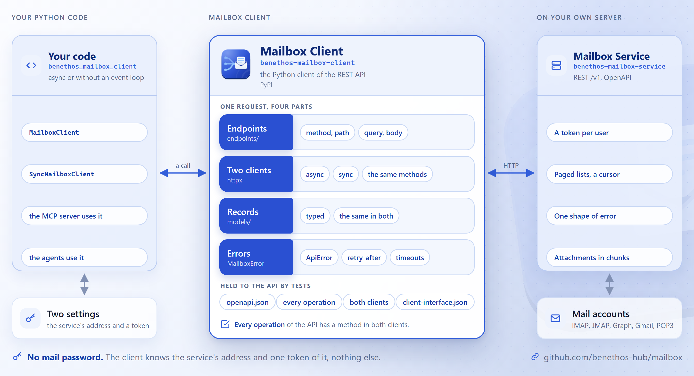

#  Mailbox Client

[](https://github.com/benethos-hub/mailbox/actions/workflows/ci.yml)
[](https://github.com/benethos-hub/mailbox/actions/workflows/ci.yml)
[](https://github.com/benethos-hub/mailbox/blob/main/LICENSE)
[](https://pypi.org/project/benethos-mailbox-client/)

[](https://pypi.org/project/benethos-mailbox-service/)
[](https://github.com/benethos-hub/mailbox/pkgs/container/benethos-mailbox-service)

[](https://pypi.org/project/benethos-mailbox-agents/)
[](https://github.com/benethos-hub/mailbox/pkgs/container/benethos-mailbox-agents)

[](https://pypi.org/project/benethos-mailbox-mcp/)
[](https://github.com/benethos-hub/mailbox/pkgs/container/benethos-mailbox-mcp)

[](https://pypi.org/project/benethos-mailbox-client/)

[](https://pypi.org/project/benethos-mailbox-common/)

[](https://github.com/sponsors/BeneODev)
[](https://paypal.me/BeneODev)

[](https://glama.ai/mcp/servers/benethos-hub/mailbox)

> **Beta, version 0.11.0.** Usable with real accounts. A breaking change
> of the API or the configuration is announced in the changelog. Stored
> data is carried forward by migrations.

The Python client of the REST API of
[`mailbox-service`](https://github.com/benethos-hub/mailbox/tree/main/packages/mailbox-service),
on PyPI as `benethos-mailbox-client`. It covers the whole REST API: it
reads, searches, sorts, drafts and sends mail of the accounts the
service holds, and administers the service: accounts, users, roles,
tokens, second factors, webhooks, the audit and the state of the
service, as far as its token allows. Every operation of the API is a
method of both clients, named like its `operationId`. The MCP server of the project,
[`mailbox-mcp`](https://github.com/benethos-hub/mailbox/tree/main/packages/mailbox-mcp),
is built on it, and so are the agents,
[`mailbox-agents`](https://github.com/benethos-hub/mailbox/tree/main/packages/mailbox-agents).

It knows the service through its REST API alone, and needs nothing but
[httpx](https://www.python-httpx.org/). The REST API follows the status
above. This package's Python interface has no stability promise yet.

Mailbox is self-hosted and has five packages. The client needs a
running service: [Install](https://github.com/benethos-hub/mailbox/blob/main/packages/mailbox-service/README.md#install)
and [First start](https://github.com/benethos-hub/mailbox/blob/main/packages/mailbox-service/README.md#first-start)
in its README.

<picture>
  <source srcset="https://raw.githubusercontent.com/benethos-hub/mailbox/main/assets/mailbox-client/architecture/architecture-dark.png" media="(prefers-color-scheme: dark)">
  
</picture>

A request goes from your code with the client over REST to the
service, and from the service to the provider of the account. In the
client it has four parts: its endpoint, one of the two clients, the
records of the answer and the errors ([Inside](#inside)).

| Package | Its part | How you get it |
|---|---|---|
| [`mailbox-service`](https://github.com/benethos-hub/mailbox/tree/main/packages/mailbox-service) | It holds the connections to your mail accounts and their credentials, encrypted. It offers one REST API for every provider and decides what a token may do. It has to be running. | [Getting started](https://github.com/benethos-hub/mailbox/blob/main/packages/mailbox-service/README.md#getting-started), before this package |
| **`mailbox-client`** | This package. The Python client of that REST API, async and sync, for your own scripts and apps. | [Install](#install) |
| [`mailbox-mcp`](https://github.com/benethos-hub/mailbox/tree/main/packages/mailbox-mcp) | The MCP server. It turns the REST API into tools for an AI assistant, on top of this client. | [Getting started](https://github.com/benethos-hub/mailbox/blob/main/packages/mailbox-mcp/README.md#getting-started) |
| [`mailbox-common`](https://github.com/benethos-hub/mailbox/tree/main/packages/mailbox-common) | What the service, the MCP server and the agents share. The client does not use it. | not needed here |
| [`mailbox-agents`](https://github.com/benethos-hub/mailbox/tree/main/packages/mailbox-agents) | Small AI agents that sort and mark mail, on top of this client. Alpha. | [Install](https://github.com/benethos-hub/mailbox/blob/main/packages/mailbox-agents/README.md#install) |

What the project is for: [the repository's README](https://github.com/benethos-hub/mailbox#readme).

**Contents**

- [Install](#install)
- [Use](#use)
- [Errors](#errors)
- [Inside](#inside)
- [Licence](#licence)

## Install

```sh
uv add benethos-mailbox-client      # or: pip install benethos-mailbox-client
```

## Use

Make a token on your user's page in the service's UI. The client reads
it from `MAILBOX_SERVICE_TOKEN`, and the address of the service from
`MAILBOX_SERVICE_URL` (default `http://127.0.0.1:8080`). Both can be
passed as arguments instead. The address carries no user or password:
it is named in the errors of the client.

For async code:

```python
from benethos_mailbox_client import MailboxClient

async with MailboxClient() as mailbox:
    me = await mailbox.get_me()
    for account in me.accounts:
        page = await mailbox.list_messages(account.id, folder="inbox", limit=10)
        for summary in page.items:
            print(account.email, summary.sender, summary.subject)
```

For code without an event loop, `SyncMailboxClient` has the same
methods (`close()` for `aclose()`) and answers the same records:

```python
from benethos_mailbox_client import Address, SyncMailboxClient, message_body

with SyncMailboxClient() as mailbox:
    body = message_body(
        to=[Address("someone@example.org")],
        cc=[],
        bcc=[],
        subject="Hello",
        text="Hi there",
        html=None,
        reference=None,
    )
    mailbox.send_message("acc_...", body, idempotency_key="hello-1")
```

Administering the service works the same way. A user with a grant and a
token for it:

```python
from benethos_mailbox_client import Grant, SyncMailboxClient

with SyncMailboxClient() as mailbox:
    user = mailbox.create_user(
        "desktop",
        grants=[Grant(accounts=("acc_...",), allow=("mail.read", "drafts"))],
    )
    made = mailbox.create_token(user.id, "laptop")
    print(made.secret.get_secret_value())  # shown this once
```

A message comes as a `Message`, a message in a page, a changed one
and a written draft as a `MessageSummary`, its sender and recipients
as `Address` records.

A secret the service shows once, a new token, a one-time password, a
webhook's signing secret or the address of a link to an attachment,
comes as a `Secret`: `repr` and `str` show
stars, so it reaches no log by accident, and `get_secret_value()` reads
it. A list of messages or drafts answers a `Page` of summaries, with
`next_cursor` for the next page and, across accounts, `not_answering`
for those that did not answer, as text, and `incomplete`, the same
accounts as `NotAnswering` records with the error's `code` and
`message`. The other lists that page, of accounts,
threads, users, sends and the audit, answer `Paged`, with `next_cursor`
as well.

Beside the operations, `update_messages` and `trash_messages` are
`batch_messages` for one kind of change, and `message_body` builds the
body of a send or a draft, as in the example above.

`request(method, path, ...)` sends any request and answers its JSON as
it comes, e.g. for a field a record leaves out. The routes and their
fields:
[`docs/mailbox-service/openapi.json`](https://github.com/benethos-hub/mailbox/blob/main/docs/mailbox-service/openapi.json).

The token travels in a header. Over http the client talks only to this
machine. To another machine it needs https, or
`MAILBOX_SERVICE_ALLOW_HTTP=1` (`allow_http=True`) for a network you
trust, such as between containers. Over http the client takes no proxy
from the environment, so the token cannot reach one in clear. Over
https it follows `HTTPS_PROXY` and the like.

A client made without an address or a token reads the environment when
it is made. A program that makes clients for a long time can read it
once, with `from_environment()`:

```python
from benethos_mailbox_client import MailboxClient, from_environment

found = from_environment()
client = MailboxClient(found.url, found.token, allow_http=found.allow_http)
```

## Errors

Everything the client raises is a `MailboxError`:

| Error | When |
|---|---|
| `ConfigurationError` | no token, or an address it refuses |
| `ServiceUnavailableError` | the service cannot be reached |
| `ServiceTimeoutError` | the service took the request but did not answer in time |
| `ApiError` | the API answered with an error: `status`, `code`, `message`, and `retry_after`, the seconds a limit asks to wait, else `None`. An answer of another shape has the code `unexpected_response`. So has one that cannot be read, with the status `502` |

## Inside

Each endpoint is described once, in `endpoints/`, one module per
resource of the API: its method, path, query, body and how its answer
becomes a record of `models/`. That package sends nothing.
`MailboxClient` sends those requests with `httpx.AsyncClient`,
`SyncMailboxClient` with `httpx.Client`, and a method of either is one
line made from its endpoint, with the endpoint's name, docstring and
signature, `get_attachment`, which streams, a few more. A test holds
every operation of the API to a method of both clients, except the
route of a link to an attachment, whose URL another service fetches
without a token. What both share stands
beside them: the address and the token (`environment.py`), the shape
of a request (`calls.py`), how an answer or a failure is read
(`answers.py`) and an attachment read in chunks (`attachments.py`).

## Licence

MIT, see [LICENSE](https://github.com/benethos-hub/mailbox/blob/main/LICENSE).
