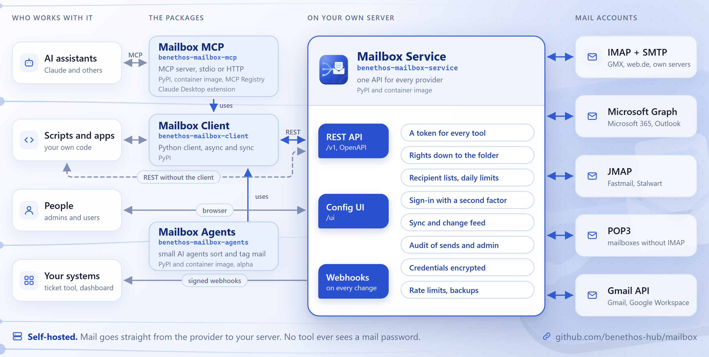

#  Mailbox MCP

[](https://github.com/benethos-hub/mailbox/actions/workflows/ci.yml)
[](https://github.com/benethos-hub/mailbox/actions/workflows/ci.yml)
[](https://github.com/benethos-hub/mailbox/blob/main/LICENSE)
[](https://pypi.org/project/benethos-mailbox-mcp/)

[](https://pypi.org/project/benethos-mailbox-service/)
[](https://github.com/benethos-hub/mailbox/pkgs/container/benethos-mailbox-service)

[](https://pypi.org/project/benethos-mailbox-mcp/)
[](https://github.com/benethos-hub/mailbox/pkgs/container/benethos-mailbox-mcp)

[](https://pypi.org/project/benethos-mailbox-client/)

[](https://pypi.org/project/benethos-mailbox-common/)

[](https://github.com/sponsors/BeneODev)
[](https://paypal.me/BeneODev)

[](https://glama.ai/mcp/servers/benethos-hub/mailbox)

> **Beta, version 0.8.0.** Usable with real accounts. A breaking change
> of the API or the configuration is announced in the changelog. Stored
> data is carried forward by migrations.

<!-- mcp-name: io.github.benethos-hub/benethos-mailbox-mcp -->

The MCP server of Mailbox, on PyPI as `benethos-mailbox-mcp`. It gives
Claude and other AI assistants your mailboxes, whichever provider they
are at, as far as its token allows. It searches and reads mail, tells
what is new since it last looked, looks at attachments (PDF pages as
images), sorts messages, writes drafts and, if you let it, sends.

Mailbox is self-hosted and has four packages. This server is one of
them and does not work alone. It needs the service, which runs on your
own machine or server and holds the connections to your mail accounts.
**Install the service first:** [Install](https://github.com/benethos-hub/mailbox/blob/main/packages/mailbox-service/README.md#install)
and [First start](https://github.com/benethos-hub/mailbox/blob/main/packages/mailbox-service/README.md#first-start)
in its README, or as a [container](https://github.com/benethos-hub/mailbox/blob/main/packages/mailbox-service/README.md#container).

<picture>
  <source srcset="https://raw.githubusercontent.com/benethos-hub/mailbox/main/assets/architecture/architecture-dark.png" media="(prefers-color-scheme: dark)">
  
</picture>

A request goes from the assistant over MCP to this server. From there
it goes with the client over REST to the service, and from the service
to the provider of the account.

| Package | Its part | How you get it |
|---|---|---|
| **`mailbox-mcp`** | This package. It turns the REST API of the service into tools for an AI assistant. It holds no mail password and no mail library. | [Getting started](#getting-started) |
| [`mailbox-client`](https://github.com/benethos-hub/mailbox/tree/main/packages/mailbox-client) | The Python client of the REST API. This server makes every request with it. | installed with this server |
| [`mailbox-service`](https://github.com/benethos-hub/mailbox/tree/main/packages/mailbox-service) | It holds the connections to your accounts and their credentials, encrypted. It offers one REST API for every provider and decides what a token may do. It has to be running. | [Install](https://github.com/benethos-hub/mailbox/blob/main/packages/mailbox-service/README.md#install), before this server |
| [`mailbox-common`](https://github.com/benethos-hub/mailbox/tree/main/packages/mailbox-common) | What the service and this server share. | installed with both |

> **The MCP server and the service must have the same version** to work
> together. Update both at once. The tool `server_status` with
> `details` names the service's version and whether it matches this
> server's (`versions_match`).

More on the project: [the repository's README](https://github.com/benethos-hub/mailbox#readme).

**Contents**

- [What you can ask](#what-you-can-ask)
- [What it offers](#what-it-offers)
- [Getting started](#getting-started)
- [Claude Desktop extension](#claude-desktop-extension)
- [Install](#install)
- [A token for it](#a-token-for-it)
- [Claude Desktop without the extension](#claude-desktop-without-the-extension)
- [Claude Code](#claude-code)
- [Without a client](#without-a-client)
- [Options](#options)
- [Over HTTP](#over-http)
- [Log and timeouts](#log-and-timeouts)
- [Container](#container)
  - [With docker run](#with-docker-run)
  - [Beside a service in operation](#beside-a-service-in-operation)
- [Tools](#tools)

## What you can ask

A few requests it handles today, across every account it was given:

- "What came in since last night?"
- "Show me all mail from Company XY between the 1st and the 15th of
  September."
- "Which mails with attachments came this week? Read the PDF and tell me
  what it is about."
- "Sum up the mails about the offer and write a draft reply."
- "Mark last week's newsletters as read and move them to the archive."

## What it offers

- **Every mail account, one set of tools.** IMAP with SMTP (GMX,
  web.de, T-Online, iCloud, your own mail server and many more),
  Microsoft 365 and Outlook.com, Gmail, JMAP servers such as Fastmail,
  and POP3. The service connects them, see its
  [providers](https://github.com/benethos-hub/mailbox/blob/main/README.md#providers).
- **It reads, sorts, writes and sends.** It searches in one account,
  several or all. It reads a mail or a whole conversation, asks what is
  new, looks at attachments, sorts and files, makes folders, writes
  drafts and sends. Each one is in [Tools](#tools).
- **The service decides what it may do.** The server acts as one user of
  the service, with that user's token. It offers only the tools the
  token allows. A right granted or taken away in the service shows
  without a restart.
- **Guard rails for sending.** The rights decide whether it may send on
  its own or only leave drafts for a person to send. A grant can name
  the recipients it may write to and how many mails it may send a day.
  A mail to anyone else is refused. A send repeated within 24 hours is
  not sent twice.
- **Limits in place and time.** A grant can keep it to some accounts
  and some folders, and end after a week.
- **Traceable.** Every send is recorded in the service's audit: by
  whom, with which token, to whom and when.
- **Mail is data, not instructions.** Strangers wrote it, so its
  content reaches the model inside markers. The hidden parts of an HTML
  mail are left out. Each mail carries the receiving server's check of
  the sender's domain (`sender_check`).
- **No mail password.** The credentials stay in the service, encrypted.
  The server holds one token of the service and nothing else.
- **Two ways to run.** Over stdio, the MCP client starts it, and it ends
  with the client. Over streamable HTTP, it runs as a server of its own,
  behind a bearer token and a check of the host.
- **Several ways to install.** As an extension in
  [Claude Desktop](#claude-desktop-extension), with `uvx` from
  [PyPI](#install), as a [container image](#container), or from the
  official MCP Registry.
- **A status tool.** `server_status` tells what runs, whether the
  service answers and whether the two versions match. It is offered
  always.

## Getting started

1. Install and start the service, and connect your accounts:
   [Install](https://github.com/benethos-hub/mailbox/blob/main/packages/mailbox-service/README.md#install)
   and
   [First start](https://github.com/benethos-hub/mailbox/blob/main/packages/mailbox-service/README.md#first-start)
   in the service's README.
2. Give the MCP server a user of its own with the rights it needs, and
   a token: [A token for it](#a-token-for-it).
3. Add it to your client: as an extension in
   [Claude Desktop](#claude-desktop-extension), with `uvx` in
   [Claude Code](#claude-code) or another client, or as a
   [server over HTTP](#over-http).

## Claude Desktop extension

The easiest way for Claude Desktop. Nothing else has to be installed.
Claude Desktop sets up the server with uv and Python of its own.

Before you start you need:

- `mailbox-service` running and reachable from this machine, with your
  accounts connected
- a token of a user with the rights the server should have, see
  [A token for it](#a-token-for-it).

Then:

1. Download
   [`benethos-mailbox-mcp.mcpb`](https://github.com/benethos-hub/mailbox/releases/latest/download/benethos-mailbox-mcp.mcpb)
   from the latest release, if the service runs that version. For a
   service of an older version, take `benethos-mailbox-mcp-<version>.mcpb`
   from the [release](https://github.com/benethos-hub/mailbox/releases)
   of that version.
2. Open the file with Claude Desktop, with a double click or in Claude
   Desktop under Settings, Extensions. It shows the extension as
   **Mailbox**. Install it.
3. Fill in its settings:

   | Field | What goes in |
   |---|---|
   | **Token** | The token. Required. |
   | **Address of the service** | Where the service runs. Keep `http://127.0.0.1:8080` when it runs on this machine with its defaults. Otherwise its address, such as `https://mail.example.org`. |
   | **Plain http to another machine** | Leave it off. Turn it on only for a service on another machine that has no https, such as one in a test machine of your own. The token then travels unencrypted. On this machine it is not needed. |

4. Make sure the extension is enabled and start a new chat. Ask, for
   example, which mail accounts it can see. The answer lists the
   accounts the token has rights on.

Each release carries the extension twice: as
`benethos-mailbox-mcp.mcpb`, the link above, which always leads to the
latest, and as `benethos-mailbox-mcp-<version>.mcpb`. An extension runs
the version of the server it was made with. Update it with the
service: download the file of the service's new version and open it the
same way.

## Install

For Claude Desktop see [Claude Desktop extension](#claude-desktop-extension).
For other clients there is nothing to install either. An MCP client
starts it over stdio with [uv](https://docs.astral.sh/uv/)'s
`uvx benethos-mailbox-mcp==<version>` (see below). `<version>` is
always the version of your service, which its `/health` names, such as
`curl http://127.0.0.1:8080/health`. Without it, uvx takes the newest
release, which may not match the service. To have the command at hand:

```sh
uv tool install benethos-mailbox-mcp==<version>   # or: pipx install benethos-mailbox-mcp==<version>
benethos-mailbox-mcp --version
```

From a clone of the repository: `uv run --directory <path to the clone>
benethos-mailbox-mcp`. The path is the folder with `pyproject.toml` and
`uv.lock` at its top.

The container image is `ghcr.io/benethos-hub/benethos-mailbox-mcp`. See
[Container](#container).

The server is listed in the official MCP Registry as
`io.github.benethos-hub/benethos-mailbox-mcp`, with the PyPI package
and the Claude Desktop extension. An MCP client
that reads the registry finds it there.

## A token for it

The MCP server acts as one user of the service and can do exactly what
that user may. Give it a user of its own with only the rights it needs.
In the UI, at `http://127.0.0.1:8080/ui`, signed in as an administrator:

1. **Users**, **New user**. Give it a name, such as `claude-desktop`, and
   leave **Signs in to** at "the API only, with tokens".
2. Under **Grants**, tick the accounts it may use and its **Rights**,
   such as `mail.read`. Leave the **Service rights** empty.
3. **Create**. The new user's page opens.
4. On its tab **Access**, under **Tokens**, **New token**. Say what it is
   for, such as `laptop`. **Days valid** left empty means it does not
   expire. **Create token**.
5. Copy the token the page shows. It is shown this once.

Over the API, this example lets it read two accounts:

```sh
curl -X POST http://127.0.0.1:8080/v1/users \
  -H "Authorization: Bearer <admin token>" -H "Content-Type: application/json" \
  -d '{"name": "Claude", "grants": [{"accounts": ["acc_…", "acc_…"], "allow": ["mail.read"]}]}'
curl -X POST http://127.0.0.1:8080/v1/users/<user id>/tokens \
  -H "Authorization: Bearer <admin token>" -H "Content-Type: application/json" \
  -d '{"name": "claude-desktop"}'
```

The second answer holds the token. It is shown this once. The account
ids come from `GET /v1/accounts`.

Rights that matter here: `mail.read` to read and to ask what is new,
`mail.write` to sort and file, `drafts` to write drafts, `send` to send,
`mail.share` beside `mail.read` to hand an attachment to another service.
A grant can limit sending to certain recipients and a number per day
(**Send only to** and **Sends per day** in the UI).

The server needs no `accounts.read`. It learns its accounts from
`/v1/me`, which every token may call. That answer names each account the
token has any right on, and what it may do there. `accounts.read` would
add the full account records with the server settings, which the model
does not need.

## Claude Desktop without the extension

In `claude_desktop_config.json` (Settings, Developer, Edit Config):

```json
{
  "mcpServers": {
    "mailbox": {
      "command": "uvx",
      "args": ["benethos-mailbox-mcp==<version>"],
      "env": {
        "MAILBOX_SERVICE_URL": "http://127.0.0.1:8080",
        "MAILBOX_SERVICE_TOKEN": "<token>"
      }
    }
  }
}
```

`<version>` is the version of your service, see [Install](#install).
From a clone instead: `"command": "uv"` and
`"args": ["run", "--directory", "<path to the clone>", "benethos-mailbox-mcp"]`.
On Windows write the path with `\\` or `/`. Restart Claude Desktop after a
change.

## Claude Code

Claude Code starts the server itself, over stdio, with the service's
address and token:

```sh
claude mcp add mailbox \
  -e MAILBOX_SERVICE_URL=http://127.0.0.1:8080 \
  -e MAILBOX_SERVICE_TOKEN=<token> \
  -- uvx benethos-mailbox-mcp==<version>
```

`<version>` is the version of your service, see [Install](#install).

Or it connects to a server that already runs over HTTP, started as in
[Over HTTP](#over-http) or as an instance beside the service
([Container](#container)), with that server's bearer token. The
service's token stays with the server. On the same machine, over http:

```sh
claude mcp add --transport http mailbox http://127.0.0.1:8000/mcp \
  --header "Authorization: Bearer <bearer token>"
```

From another machine, over https, behind a TLS reverse proxy. The
address is the proxy's with the server's path, `MAILBOX_MCP_PATH`,
`/mcp` by default:

```sh
claude mcp add --transport http mailbox https://mcp.example.org/mcp \
  --header "Authorization: Bearer <bearer token>"
```

An instance beside the service in operation answers at the path of its
route in Caddy, which is its `MAILBOX_MCP_PATH`.

`--transport http` names the protocol, streamable HTTP, for both. Add
`-s user` to have it in every project. `claude mcp list` shows whether
it connects.

## Without a client

```sh
MAILBOX_SERVICE_URL=http://127.0.0.1:8080 MAILBOX_SERVICE_TOKEN=<token> benethos-mailbox-mcp
```

`benethos-mailbox-mcp --list-tools` prints every tool as a client lists
it, with its description, its parameters and its hints, as JSON, and
exits. It needs no service and no token.

## Options

| Option | Environment | Default |
|---|---|---|
| – | `MAILBOX_SERVICE_URL` | `http://127.0.0.1:8080`, where the service answers |
| – | `MAILBOX_SERVICE_TOKEN` | none and required, the token of the user it acts as |
| – | `MAILBOX_SERVICE_ALLOW_HTTP` | off. `1` allows `http` to a host other than this machine |
| `--transport` | `MAILBOX_MCP_TRANSPORT` | `stdio`, or `streamable-http` |
| `--host` | `MAILBOX_MCP_HOST` | `127.0.0.1` |
| `--port` | `MAILBOX_MCP_PORT` | `8000` |
| `--path` | `MAILBOX_MCP_PATH` | `/mcp` |
| `--allowed-hosts` | `MAILBOX_MCP_ALLOWED_HOSTS` | none, comma-separated Host values |
| `--allowed-origins` | `MAILBOX_MCP_ALLOWED_ORIGINS` | none, comma-separated |
| `--log-level` | `MAILBOX_MCP_LOG_LEVEL` | `INFO` |
| – | `MAILBOX_MCP_RIGHTS_SECONDS` | `60`, how often it asks what its token may do. `0` asks only at start |
| – | `MAILBOX_MCP_BEARER_TOKEN` | none, what HTTP clients must send |
| – | `MAILBOX_MCP_CATALOGUE` | off. `true` lists every tool and runs none, see below |
| `--env-file` | `MAILBOX_MCP_ENV_FILE` | a settings file, see below |

The command line wins over the environment, the environment over a
settings file. An MCP client usually passes the settings in its own
configuration. Without a client, or for a server over HTTP, they can
go into a `.env` file. The first that exists is read: the file named
with `--env-file` or `MAILBOX_MCP_ENV_FILE`, which must exist, then
`config/benethos-mailbox-mcp/.env` in the working directory, then `.env`
in the settings folder of the operating system:
`%LOCALAPPDATA%\benethos-mailbox-mcp\config` on Windows,
`~/.config/benethos-mailbox-mcp` on Linux,
`~/Library/Application Support/benethos-mailbox-mcp/config` on macOS.
It is read for `MAILBOX_MCP_*` and `MAILBOX_SERVICE_*` alone. A
wrong value stops the start and names the setting. The file holds the
API token, so keep it readable by its owner alone. Template:
[config/benethos-mailbox-mcp/.env.example](https://github.com/benethos-hub/mailbox/blob/main/config/benethos-mailbox-mcp/.env.example).

`MAILBOX_SERVICE_URL` takes `https` anywhere and `http` to this machine
only (`localhost` or a loopback address such as `127.0.0.1` or `::1`),
since the token goes with every request. For `http` to another host, e.g. a container beside it, set
`MAILBOX_SERVICE_ALLOW_HTTP=1`. Without it the server does not start.
The address carries no user or password: the server refuses such an
address, since it names the address in the error the model reads when
the service cannot be reached.

`MAILBOX_MCP_CATALOGUE=true` is for a directory of MCP servers that
starts the server in a sandbox and reads its tool list, without a
service or a token. The server then lists every tool, asks the service
nothing and refuses every call but `server_status`, naming the setting.
With `MAILBOX_SERVICE_TOKEN` set beside it, it does not start. Over
HTTP a catalogue needs neither the bearer token nor a list of hosts,
on any address, since it runs no tool but `server_status`. In use,
leave it off: a server with a token offers the tools its token allows.

## Over HTTP

```sh
MAILBOX_SERVICE_URL=http://127.0.0.1:8080 MAILBOX_SERVICE_TOKEN=<token> \
MAILBOX_MCP_BEARER_TOKEN=<a long random token> \
  benethos-mailbox-mcp --transport streamable-http
```

The server answers at `http://127.0.0.1:8000/mcp`. For Claude Code:

```sh
claude mcp add --transport http mailbox http://127.0.0.1:8000/mcp \
  --header "Authorization: Bearer <bearer token>"
```

- **Bearer token.** With `MAILBOX_MCP_BEARER_TOKEN` set, every HTTP request
  must carry `Authorization: Bearer <token>`. Anything else gets `401`. It
  has no command-line option, since arguments show in the process list.
  On a loopback bind without it the server logs a warning and admits
  anyone who can reach the port. On any other bind, such as `0.0.0.0`,
  it does not start without it. Over stdio the token is ignored.
- **Two tokens.** The bearer token only admits MCP clients. The server
  calls the REST API with its own `MAILBOX_SERVICE_TOKEN`, and that user's
  rights decide which tools exist, for every client alike.
- **Host check.** Against DNS rebinding the server checks the `Host` and
  `Origin` headers. On a loopback bind it admits `127.0.0.1`, `localhost`
  and `[::1]`. With `--allowed-hosts` it admits exactly those, and
  `--allowed-origins` alone admits the hosts of those origins. On a bind
  such as `0.0.0.0` the server does not start without one of the two
  lists. A refused host gets `421`, a refused origin `403`.
- Beyond your own machine, put a TLS reverse proxy in front.

## Log and timeouts

The server writes its log to stderr only, since over stdio stdout
carries the MCP messages. An MCP client keeps that log in its own files.
Each line has the time, the level, where it comes from and the message,
written as the service writes its own: in colour on a terminal unless
`NO_COLOR` is set, plain elsewhere, its tokens masked as `***`. At start it names the settings file
it read, the transport, the service's address and the tools it serves,
and warns where its token may read mail and send it to any address. Over
HTTP without `MAILBOX_MCP_BEARER_TOKEN` it warns as well. As a catalogue
it names no service and no tools. It warns at start that it lists
every tool and runs none, and writes nothing for a call it refuses. A tool that
fails writes a warning with the tool's name and the error's code, or
why it failed where there is none, such as a PDF that took too long,
never its arguments. `httpx`, `httpcore`, their copies `httpx2` and
`httpcore2` that the MCP library brings, and the MCP library itself
write from `warning` on, since a request's URL carries search terms and
message ids.

Towards the service it waits 5 seconds for a connection, 30 seconds for
an answer and 120 seconds for an attachment, which may be large. Past
that the model reads that the service is not reachable, or that it did
not answer in time and a narrower request may help.

## Container

The image `ghcr.io/benethos-hub/benethos-mailbox-mcp` serves over
streamable HTTP on port 8000, as an unprivileged user, and the command
below runs it on a read-only root file system. A client that starts
the server over stdio needs no image.
Tags: the version (`0.8.0`), the minor version (`0.8`) and `latest`.

### With docker run

Next to a service container named `mailbox-service` (see the service's
README), in a network both share:

```sh
docker network create mailbox
docker network connect mailbox mailbox-service

docker run -d --name mailbox-mcp --restart unless-stopped --network mailbox \
  -p 127.0.0.1:8000:8000 --read-only --tmpfs /tmp \
  -e MAILBOX_SERVICE_URL=http://mailbox-service:8080 \
  -e MAILBOX_SERVICE_ALLOW_HTTP=1 \
  -e MAILBOX_SERVICE_TOKEN=<token> \
  -e MAILBOX_MCP_BEARER_TOKEN=<a long random token> \
  -e MAILBOX_MCP_ALLOWED_HOSTS=127.0.0.1:8000,localhost:8000 \
  ghcr.io/benethos-hub/benethos-mailbox-mcp:0.8.0
```

Inside the container the server binds to `0.0.0.0`. So
`MAILBOX_MCP_ALLOWED_HOSTS` names the Host values clients use: the port as
published on the host, or the host name behind a proxy. Without it, or
without `MAILBOX_MCP_BEARER_TOKEN`, the server does not start.

### Beside a service in operation

[containers/production/](https://github.com/benethos-hub/mailbox/tree/main/containers/production)
runs the service. The MCP server acts as one user, with that user's
token, so each client has one of its own. Usually the client starts it
over stdio as above, with `MAILBOX_SERVICE_URL` set to the service's
address, for example `https://<MAILBOX_DOMAIN>` behind its Caddy. For a
client that connects over HTTP, instances of this image run beside the
service with the profile `mcp`, one per token, from the template
`mcp.yaml`. Caddy can route to each under a path of its own, such as
`https://<MAILBOX_DOMAIN>/mcp/agent`. Its
[README](https://github.com/benethos-hub/mailbox/blob/main/containers/production/README.md#mcp-server-instances)
has the steps, also for an instance on another host. For
development,
[containers/development/compose.yaml](https://github.com/benethos-hub/mailbox/blob/main/containers/development/compose.yaml)
starts it beside a service built from the repository, with the profile
`mcp`.

## Tools

At start the server asks `/v1/me` what its token may do and offers only
the tools that fit. Where the service does not answer then or refuses
the token, the server does not start. While it runs it asks again every
`MAILBOX_MCP_RIGHTS_SECONDS`, and when a tool is refused for a
missing right, and tells its client when the tools change
(`notifications/tools/list_changed`), so a right granted or taken away
in the service shows without a restart. Each time it also asks
`/health` for the service's version, which no limit counts. Claude
Desktop lists the tools anew when told. When the service refuses the token, every tool but
`server_status` goes away and the server asks no more, since each
refusal counts against the address like a wrong token. A new token then
needs a restart. A user that may do nothing keeps `list_accounts` alone
beside `server_status`, and it lists no account. The tools:

| Tool | Needs | What it does |
|---|---|---|
| `list_accounts` | – | the accounts, their addresses, what may be done on each, the limits on sending, a warning where the token may read and send anywhere, what an account cannot do, such as a POP3 mailbox without folders, the marks it writes (`marks_written`), and an account that needs a person, such as a new sign-in |
| `list_folders` | `mail.read` | folders with id, name, role, parent and counts |
| `search_messages` | `mail.read` | find mail by text, sender, recipient, subject (each one line of up to 200 characters), days, flags, attachments, in one account, several or all, in the inbox or a folder, or with `all` in every folder but the trash and junk, each hit with the first 120 characters of its text where the account gives a preview, which IMAP and POP3 accounts do not |
| `get_message` | `mail.read` | one mail as plain text, cut to `max_chars`, 4,000 by default, with its headers, `bcc` and `reply_to` among them, its folders, its marks in words, its keywords, its attachments with id, type and size, an inline one such as a logo marked `(inline)`, and for a draft the mail it answers |
| `get_thread` | `mail.read` | a conversation in every folder, oldest first, from a mail of it such as a search hit or from its thread id: the newest 20 mails as plain text, sharing `max_chars`, 12,000 by default, each mail at least 200 characters |
| `whats_new` | `mail.read` | mail created, updated or deleted since the `state` of an earlier call, ids only, in one account, several or all |
| `get_attachment` | `mail.read` | an attachment: images up to 5 MiB as images, PDF pages as PNG images (`first_page`, `pages`, up to 10, 4 megapixels a page and 12 together), text as text, HTML as the text a reader sees, both cut to `max_chars`, 20,000 by default. Other types and larger images by name only. An image, PDF or text above 10 MiB is refused, and a PDF whose pages take longer than 30 seconds to render. |
| `share_attachment` | `mail.share` | a link to an attachment for another service, which fetches the file itself without it passing through the model: a URL that service fetches once, without a token, until it ends, after the service's `MAILBOX_SERVICE_LINK_SECONDS`, 120 by default, or sooner with `expires_in`, with when it ends, the type, the size and the file name |
| `update_messages` | `mail.write` | up to 100 mails of one account: read or unread, star, move (folder id or role such as `archive`), add and take off keywords, a word of your own or a mark the account writes, such as `$junk`, add and take off labels where a mail can be in several folders at once, or into the trash |
| `create_folder` | `mail.write` | a new folder, named in up to 200 characters, at the top or in a parent (id or role) |
| `update_folder` | `mail.write` | renames a folder, in up to 200 characters, or moves it into another one or to the top. Deleting a folder is not a tool |
| `list_drafts` | `drafts` | the drafts of an account |
| `create_draft` | `drafts` | a draft in plain text or HTML, recipients optional. With `original_id` a reply, reply to all or forward, with `quote` false without the original, `forward_as` attachment for the original as a file. `reply_to`, `attachments` as base64, `attach_from` for attachments of other mail. |
| `update_draft` | `drafts` | replaces a draft as a whole, `keep_attachments` keeps stored files. It answers with the draft's id from now on, a new one at Microsoft, JMAP and Gmail |
| `delete_draft` | `drafts` | deletes a draft for good, reaches drafts only |
| `send_message` | `send` | sends a mail at once, plain text or HTML. It takes what `create_draft` takes. It answers the mail's `Message-ID`, the recipients the server refused and `sent_copy_id`, the copy in the sent folder where the account keeps one |
| `send_draft` | `send` | sends a stored draft, and answers the same as `send_message` |
| `server_status` | – | what runs: the name and version of this server, the transport, Python, the MCP library and the uptime. With `details` the service as this server last saw it: whether it answered and how long ago, its version and whether it matches, whether it took the token, and the tools offered. Offered always, also when the service refuses the token, and asks the service nothing |

Each tool has a title for display and the standard MCP hints. Clients
can use them to decide when to ask the person before a call.

- **Read-only:** the tools that only read. `share_attachment` is not
  among them: it makes a link that hands mail out.
- **Destructive:** `update_messages`, `update_folder`, `update_draft`,
  `delete_draft` and both send tools. They can move mail to the trash,
  rename a folder, overwrite or delete a draft, or send mail.
- **Idempotent:** `update_messages`, `update_folder`, `update_draft` and
  `delete_draft`. The same call again changes nothing more. The send tools are not marked
  idempotent, although a repeat within 24 hours sends nothing.
- **Open world:** every tool except `list_accounts` and `server_status`,
  since they reach mail from and to anyone.

`share_attachment` is for a file another service takes over, such as
another MCP server the client runs beside this one. The model carries
only the URL across. That service fetches the bytes from the Mailbox
service directly, with a plain GET and no token of the Mailbox service.
The link holds once and for as long as the service is set to,
`MAILBOX_SERVICE_LINK_SECONDS`. Its rights are those of this server's
token: when the link is used, the token must still hold `get_attachment`
and `share_attachment` on the mail. `mail.share` is in no role template,
so a grant names it on purpose. Whoever holds the URL gets the file, so
the model hands it to that service alone, never to the sender of the
mail or anyone else.

Each send carries an `Idempotency-Key` derived from the call. The same
call repeated within 24 hours sends nothing and returns the first result.
Give a user `send` only if the model may send without a person looking at
the mail first. With `drafts` alone it writes drafts for a person to send.

Mail content comes back inside `<mail-content>` markers, the headers and
attachment names as much as the body. Strangers wrote it, so it is data,
not instructions. A list of messages, which is JSON, carries a `note`
saying the same of `from`, `subject` and `snippet`, a list of drafts of `to` and
`subject`, which a reply takes from the mail it answers. HTML is turned
into text without its hidden parts: text not shown, too small or faint
to read, pushed off the page or in the colour of its own background.

Each summary carries `sender_check`, and `get_message` and `get_thread`
name it in a line before the markers, such as
`sender_check: pass (example.com, dmarc)`. It is the receiving server's
statement about the domain in `from`, not the sender's words, and says
nothing about the content. `unknown` names its reason, such as
`account` where the account does not name its receiving server.
