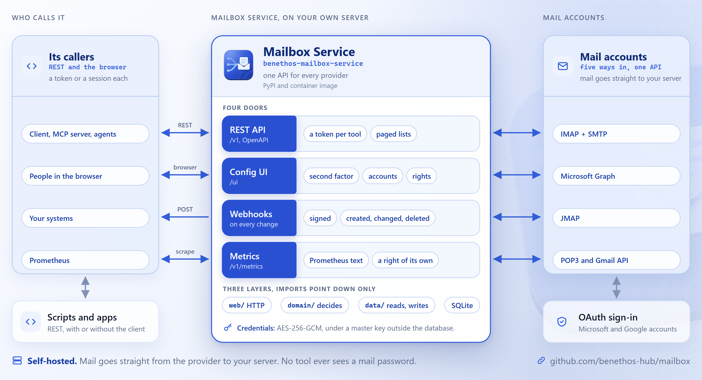

#  Mailbox Service

[](https://github.com/benethos-hub/mailbox/actions/workflows/ci.yml)
[](https://github.com/benethos-hub/mailbox/actions/workflows/ci.yml)
[](https://github.com/benethos-hub/mailbox/blob/main/LICENSE)
[](https://pypi.org/project/benethos-mailbox-service/)

[](https://pypi.org/project/benethos-mailbox-service/)
[](https://github.com/benethos-hub/mailbox/pkgs/container/benethos-mailbox-service)

[](https://pypi.org/project/benethos-mailbox-agents/)
[](https://github.com/benethos-hub/mailbox/pkgs/container/benethos-mailbox-agents)

[](https://pypi.org/project/benethos-mailbox-mcp/)
[](https://github.com/benethos-hub/mailbox/pkgs/container/benethos-mailbox-mcp)

[](https://pypi.org/project/benethos-mailbox-client/)

[](https://pypi.org/project/benethos-mailbox-common/)

[](https://github.com/sponsors/BeneODev)
[](https://paypal.me/BeneODev)

[](https://glama.ai/mcp/servers/benethos-hub/mailbox)

> **Beta, version 0.11.1.** Usable with real accounts. A breaking change
> of the API or the configuration is announced in the changelog. Stored
> data is carried forward by migrations.

The service of Mailbox, on PyPI as `benethos-mailbox-service`: one REST
API (OpenAPI 3.1) for several mail providers and accounts, with a
configuration UI in the browser. It runs permanently on your own machine
or server, holds the connections to the accounts, keeps their
credentials encrypted and syncs in the background. It keeps a feed of
what changed in the mailboxes and posts it to webhooks.

Mailbox is self-hosted and has five packages. The service is the one
that works alone, and the others build on it. Scripts and apps reach
mail through the Python client, AI assistants through the MCP server,
the agents through the client as well, each with a token of its own. None of them holds a mail password.

<picture>
  <source srcset="https://raw.githubusercontent.com/benethos-hub/mailbox/main/assets/mailbox-service/architecture/architecture-dark.png" media="(prefers-color-scheme: dark)">
  
</picture>

A request comes in over REST, from the client, from the MCP server and
the agents on top of it, or from any program that speaks HTTP. The
service checks the token and its rights, and goes to the provider of the
account. People use the configuration UI in the browser, your systems
get a signed webhook for each change, and Prometheus reads the metrics.

| Package | Its part | How you get it |
|---|---|---|
| **`mailbox-service`** | This package. It holds the connections to your accounts and their credentials, encrypted. It offers one REST API for every provider and a configuration UI, and decides what a token may do. | [Getting started](#getting-started) |
| [`mailbox-client`](https://github.com/benethos-hub/mailbox/tree/main/packages/mailbox-client) | The Python client of the REST API, async and sync, for your own scripts and apps. | from PyPI, where your code runs: [Install](https://github.com/benethos-hub/mailbox/blob/main/packages/mailbox-client/README.md#install) |
| [`mailbox-mcp`](https://github.com/benethos-hub/mailbox/tree/main/packages/mailbox-mcp) | The MCP server. It turns the REST API into tools for an AI assistant, on top of the client. | after the service: [Getting started](https://github.com/benethos-hub/mailbox/blob/main/packages/mailbox-mcp/README.md#getting-started) |
| [`mailbox-common`](https://github.com/benethos-hub/mailbox/tree/main/packages/mailbox-common) | What the service, the MCP server and the agents share. | installed with this package |
| [`mailbox-agents`](https://github.com/benethos-hub/mailbox/tree/main/packages/mailbox-agents) | Small AI agents that sort and mark mail through the REST API, on top of the client. Alpha. | after the service: [Install](https://github.com/benethos-hub/mailbox/blob/main/packages/mailbox-agents/README.md#install) |

> **The MCP server and the service must have the same version** to work
> together. Update both at once. The agents need a service of their own
> minor version.

What the project is for: [the repository's README](https://github.com/benethos-hub/mailbox#readme).

**Contents**

- [What it offers](#what-it-offers)
- [Getting started](#getting-started)
- [Install](#install)
- [First start](#first-start)
- [Where things live](#where-things-live)
- [Settings](#settings)
- [Logs](#logs)
- [Commands](#commands)
- [Users, rights and tokens](#users-rights-and-tokens)
- [Changes and webhooks](#changes-and-webhooks)
- [Container](#container)
  - [With docker run](#with-docker-run)
  - [With compose](#with-compose)
- [Licence](#licence)

## What it offers

- **Every provider behind one API.** IMAP with SMTP, set up from the
  address alone, JMAP servers such as Fastmail and Stalwart, POP3 for
  mailboxes without IMAP, Microsoft 365 and Outlook.com over Microsoft
  Graph, and Gmail over the Gmail API. The routes under `/v1` look the
  same for each. What each provider offers:
  [providers](https://github.com/benethos-hub/mailbox/blob/main/README.md#providers).
- **Reading.** Folders, lists and search, in one account or all at
  once. Conversations across folders. Messages as text and HTML, their
  attachments and the raw source. The receiving server's check of the
  sender's domain (`sender_check`). A message keeps its id when it
  moves.
- **Writing.** Read state, stars and keywords, moving, deleting,
  folders, drafts, and sending with reply, reply to all and forward. A
  retried send is not sent twice (`Idempotency-Key`). A send can go
  through an outbox instead: kept as a draft, sent in the background or
  at a set time, and tried again for 48 hours while the provider is away.
- **Changes.** A change feed names each message created, changed or
  deleted since a point you keep. Signed webhooks post the same events
  to a URL of your choice:
  [Changes and webhooks](#changes-and-webhooks).
- **Users and rights.** Users, roles and grants per account and per
  operation, down to folders, and grants that expire. Each script and
  each assistant gets a token of its own:
  [Users, rights and tokens](#users-rights-and-tokens).
- **Guard rails for sending.** A grant can name the recipients a token
  may write to and how many mails it may send a day.
- **Traceable.** An audit records every send: by whom, with which
  token, to whom and when. A second one records every sign-in and
  every change to users, tokens, roles, accounts and webhooks.
- **Credentials encrypted.** AES-256-GCM under a master key kept
  outside the database. Mail goes straight from the provider to your
  server, never through a third party's cloud.
- **A configuration UI.** In the browser under `/ui`: accounts, users,
  rights and tokens, reading and writing mail, the audits, webhooks,
  the status of accounts and sync, and the service log. Its sign-in
  takes a second factor, an authenticator app or a passkey.
- **Limits.** Rate limits per token, per session and per client
  address, towards each mail server, and a lockout after failed
  sign-ins: [Settings](#settings).
- **Operation.** An encrypted backup and restore, a container image,
  and compose files with HTTPS through Caddy: [Container](#container).
  Metrics for Prometheus at `GET /v1/metrics`, for a token with their
  right:
  [monitoring](https://github.com/benethos-hub/mailbox/blob/main/containers/production/mailbox-service/README.md#monitoring-with-prometheus).

## Getting started

1. Install it, from PyPI or as a container: [Install](#install) or
   [Container](#container).
2. Make the keys and the first user, and start it:
   [First start](#first-start).
3. Open `http://127.0.0.1:8080/ui`, sign in as `admin` with the
   one-time password, choose a password of your own and connect your
   accounts.
4. Give each script and each assistant a user of its own with the
   rights it needs, and a token:
   [Users, rights and tokens](#users-rights-and-tokens).
5. Work with it: over the REST API, which `/docs` shows, with the
   [Python client](https://github.com/benethos-hub/mailbox/blob/main/packages/mailbox-client/README.md),
   or from an AI assistant through the
   [MCP server](https://github.com/benethos-hub/mailbox/blob/main/packages/mailbox-mcp/README.md#getting-started).

## Install

From PyPI, with [uv](https://docs.astral.sh/uv/) or pip:

```sh
uv tool install benethos-mailbox-service      # or: pipx install benethos-mailbox-service
benethos-mailbox-service --version
```

`uvx benethos-mailbox-service ...` runs it without installing. In a clone of
the repository, every command below also works as
`uv run benethos-mailbox-service ...`.

The container image is `ghcr.io/benethos-hub/benethos-mailbox-service`. See
[Container](#container).

## First start

```sh
benethos-mailbox-service keys init              # once: the keys, prints the recovery key
benethos-mailbox-service users create-admin     # once: a user with every right, prints a one-time password
benethos-mailbox-service serve
```

- `keys init` creates the master key in the operating system's credential
  store and the data key in the database. It prints a **recovery key**
  once. Keep it apart from the machine and its backups. Without it, a
  database cannot be opened on another machine.
- `users create-admin` creates the user `admin` and prints a one-time
  password once. Sign in to the UI with it. The UI then asks for a
  password of your own, 15 characters at least. Tokens for the API are
  made in the UI, on a user's page.
- Further users are API users unless their UI sign-in is switched on:
  they work with tokens only, e.g. a script or an MCP server.
- A forgotten password: `users set-password <name>` on the host gives
  that user a new one-time password, and switches its UI sign-in on.
- Both write the secret alone to standard output and everything else to
  standard error, so it can be piped straight into a password manager.
  Printed to a terminal, it stays in its scrollback, and in a container
  or CI job, in the log of that run. Clear these afterwards.
- A lost second factor without a recovery code:
  `users reset-second-factor <name>`
  on the host removes it ([AUTHENTICATION.md](https://github.com/benethos-hub/mailbox/blob/main/docs/mailbox-service/AUTHENTICATION.md)).
- `serve` listens on `http://127.0.0.1:8080`:
  - `/ui`: the configuration UI (sign in with the user name and password)
  - `/docs`: the interactive API documentation
  - `/health`: open, for health checks

Then connect accounts in the UI (Accounts, Connect an account) or with
`POST /v1/accounts`. Each kind of account connects in its own way:

- **IMAP:** the address and an app password. The service looks up the
  servers from the address.
- **JMAP**, at Fastmail, Stalwart or any JMAP server: an API token or a
  password. It sends through JMAP.
- **POP3**, for a mailbox without IMAP: as IMAP, the inbox only,
  without folders, read state or search.
- **Microsoft:** OAuth, in the browser or with a code, through the
  project's app or one of your own. Away from `localhost` the project's
  app signs in with a code only. For the browser there, register an app
  of your own:
  [docs/mailbox-service/MICROSOFT.md](https://github.com/benethos-hub/mailbox/blob/main/docs/mailbox-service/MICROSOFT.md).
- **Gmail:** Sign in with Google in the browser, through a Google
  client of your own, or over IMAP with an app password:
  [docs/mailbox-service/GOOGLE.md](https://github.com/benethos-hub/mailbox/blob/main/docs/mailbox-service/GOOGLE.md).

## Where things live

Installed with `pip` or `uv tool`, the service keeps its settings and
data in the folders of the operating system for the user:

| System | Settings (`.env`) | Data |
|---|---|---|
| Windows | `%LOCALAPPDATA%\benethos-mailbox-service\config` | `%LOCALAPPDATA%\benethos-mailbox-service\data` |
| Linux | `~/.config/benethos-mailbox-service` | `~/.local/share/benethos-mailbox-service` |
| macOS | `~/Library/Application Support/benethos-mailbox-service/config` | `~/Library/Application Support/benethos-mailbox-service/data` |

Started in a folder that has `config/benethos-mailbox-service/` or
`data/benethos-mailbox-service/`, as the repository does, it works from
there instead. The command names what applies, never a value
of the settings:

```
benethos-mailbox-service paths
```

| What | Where |
|---|---|
| settings | the environment, or `.env` in the settings folder (the environment wins) |
| the database | `mailbox.db` in the data folder, readable by its owner only, or a schema on a PostgreSQL server (`MAILBOX_SERVICE_STORAGE=postgres`) |
| the master key | the OS credential store (keyring), or a file or variable (see `MAILBOX_SERVICE_KEY_PROVIDER`) |

The keyring is the default and the safest place. A key file is for a
server without one, or a container. It never lies in the data folder,
which a backup or a copy takes along. The service refuses it there.
`paths` suggests `master.key` in the settings folder.

A template for the settings file with every option:
[config/benethos-mailbox-service/.env.example](https://github.com/benethos-hub/mailbox/blob/main/config/benethos-mailbox-service/.env.example).

To keep the settings somewhere else, name the file. Every command takes
`--env-file PATH`, before or after the command, or reads
`MAILBOX_SERVICE_ENV_FILE`:

```
benethos-mailbox-service --env-file /etc/mailbox/service.env users create-admin
benethos-mailbox-service serve --env-file /etc/mailbox/service.env
```

A file named this way must exist. A relative path in the settings then
counts from its folder, not from the folder the service is started in:
`MAILBOX_SERVICE_DATA_DIR=data` puts the database in `/etc/mailbox/data/`.
So every command finds the same data wherever it is started. `serve`
names the settings file it read and the database at start.

## Settings

| Setting | Default | Meaning |
|---|---|---|
| `MAILBOX_SERVICE_HOST`, `MAILBOX_SERVICE_PORT` | `127.0.0.1`, `8080` | where the service listens (`serve --host/--port` win) |
| `MAILBOX_SERVICE_PUBLIC_URL` | from each request | the address people reach the service at, e.g. behind a proxy. The OAuth redirect address is built from it. It also fixes the origin and the RP ID of passkeys ([AUTHENTICATION.md](https://github.com/benethos-hub/mailbox/blob/main/docs/mailbox-service/AUTHENTICATION.md)). |
| `MAILBOX_SERVICE_FORWARDED_ALLOW_IPS` | | behind a reverse proxy: its address, whose `X-Forwarded-For` and `X-Forwarded-Proto` headers give the client address and the scheme. Empty: only a proxy on `127.0.0.1` is believed. Behind a proxy elsewhere that is not named, every visitor counts as the proxy's address. |
| `MAILBOX_SERVICE_RATE_LIMIT_PER_MINUTE` | `120` | requests a minute per API token or UI session, a burst of half as many at once. `0` switches the limit off. |
| `MAILBOX_SERVICE_RATE_LIMIT_ANONYMOUS_PER_MINUTE` | `30` | the same per client address, for requests without a credential |
| `MAILBOX_SERVICE_LOG_LEVEL` | `INFO` | `critical`, `error`, `warning`, `info`, `debug` or `trace`, see [Logs](#logs) |
| `MAILBOX_SERVICE_LOG_FORMAT` | `text` | or `json`, each line one JSON object for a log collector, see [Logs](#logs) |
| `MAILBOX_SERVICE_DATA_DIR` | the data folder, see [Where things live](#where-things-live) | where the database lives |
| `MAILBOX_SERVICE_STORAGE` | `sqlite` | or `postgres`, a schema on a PostgreSQL server, or `memory`, which keeps nothing |
| `MAILBOX_SERVICE_DATABASE_URL` | | for `postgres`: the server as `postgresql://<role>@<host>:<port>/<database>`, without a password. The schema is named after the role |
| `MAILBOX_SERVICE_DATABASE_PASSWORD_FILE` | | for `postgres`: the file holding the password of the role |
| `MAILBOX_SERVICE_DATABASE_TLS` | `verify` | for `postgres`: TLS with a checked certificate and name to any host but this one, or `off` for a private network, which the start says |
| `MAILBOX_SERVICE_DATABASE_CA_FILE` | the system's | for `postgres`: the certificates of the authorities the server's is checked against |
| `MAILBOX_SERVICE_DATABASE_START_WAIT` | `30` | for `postgres`: seconds `serve` waits for the database at start |
| `MAILBOX_SERVICE_KEY_PROVIDER` | `keyring` | where the master key lives: `keyring`, `file` or `env` |
| `MAILBOX_SERVICE_KEY_FILE` | | the key file, for `file`. Outside the data folder |
| `MAILBOX_SERVICE_MASTER_KEY` | | the recovery key, for `env` |
| `MAILBOX_SERVICE_SYNC_INTERVAL` | `300` | seconds between two polls of every folder. `0` switches the sync off. |
| `MAILBOX_SERVICE_SYNC_IDLE` | `true` | wait for the server to report a change: IMAP IDLE, with a second connection per account, or a JMAP server's event source |
| `MAILBOX_SERVICE_SYNC_WATCHERS` | `50` | accounts watched at once. An IMAP account holds a thread of its own while it waits in IDLE. Further accounts are polled only. |
| `MAILBOX_SERVICE_METRICS` | `true` | the figures of the service for Prometheus at `GET /v1/metrics`, for a token with the right `get_metrics`. Off, the route answers `404`. |
| `MAILBOX_SERVICE_THREAD_MESSAGES` | `500` | the messages a thread lists at most, the newest |
| `MAILBOX_SERVICE_THREAD_REFERENCES` | `20` | IMAP accounts, which the service threads itself: how many of the last `References` of a message count |
| `MAILBOX_SERVICE_CHANGES_DAYS` | `7` | days the change feed keeps a change |
| `MAILBOX_SERVICE_LINK_SECONDS` | `120` | seconds a link to an attachment holds at most, any value from 1 on. 60 to 300 is the range to keep to: whoever holds the URL fetches the file, and the URL stands in access logs, such as a reverse proxy's |
| `MAILBOX_SERVICE_AUDIT_DAYS` | `90` | days the audits of sends and of administration, and the ended sends of the outbox, keep a record. `0` keeps every record. |
| `MAILBOX_SERVICE_OUTBOX_RETRY_HOURS` | `48` | hours the attempts of a send in the outbox go on after it is due. Then it fails, and its draft stays |
| `MAILBOX_SERVICE_WEBHOOK_ATTEMPTS` | `8` | tries of a webhook post before its events are dropped |
| `MAILBOX_SERVICE_WEBHOOK_FIRST_RETRY` | `30` | seconds before the second try, doubled for each further one |
| `MAILBOX_SERVICE_WEBHOOK_LONGEST_RETRY` | `3600` | the longest pause between two tries, in seconds |
| `MAILBOX_SERVICE_WEBHOOK_TIMEOUT` | `10` | seconds a webhook receiver may take to answer |
| `MAILBOX_SERVICE_IMAP_REQUESTS_PER_MINUTE` | `60` | requests a minute to one account's IMAP or POP3 server, and its SMTP server. An account's `max_requests_per_minute` wins. |
| `MAILBOX_SERVICE_IMAP_BURST` | `10` | how many of them pass at once |
| `MAILBOX_SERVICE_IMAP_ATTEMPTS` | `3` | attempts at a server that does not answer, within one request |
| `MAILBOX_SERVICE_IMAP_FIRST_PAUSE` | `30` | seconds the server then rests, doubled after each further failure |
| `MAILBOX_SERVICE_IMAP_LONGEST_PAUSE` | `900` | the longest rest, in seconds |
| `MAILBOX_SERVICE_SIGN_IN_FAILURES` | `10` | failed sign-ins from one client address, wrong tokens and passwords alike, that lock it out |
| `MAILBOX_SERVICE_SIGN_IN_LOCKOUT_MINUTES` | `15` | the window the failures are counted in, and how long the lockout lasts |
| `MAILBOX_SERVICE_SIGN_IN_NAME_WAIT` | `60` | seconds a user name waits after as many failures from anywhere |
| `MAILBOX_SERVICE_PASSWORD_HASHES_AT_ONCE` | `2` | password hashes running at once, 32 MiB each |
| `MAILBOX_SERVICE_SESSION_IDLE_HOURS` | `8` | hours a UI session lives without a request |
| `MAILBOX_SERVICE_SESSION_MAX_HOURS` | `24` | hours a UI session lives at most, used or not |
| `MAILBOX_SERVICE_SESSIONS_PER_USER` | `10` | UI sessions of one user at most. A new one ends the oldest |
| `MAILBOX_SERVICE_SHOWN_ONCE_MINUTES` | `5` | minutes a secret shown once, such as a new token, waits for the page that shows it |
| `MAILBOX_SERVICE_DISCOVERY_PER_MINUTE` | `10` | autodiscovery lookups a minute per user |
| `MAILBOX_SERVICE_DISCOVERY_ISPDB` | `true` | whether autodiscovery asks Thunderbird's ISPDB (tells Mozilla the domain) |
| `MAILBOX_SERVICE_DISCOVERY_INTERNAL_HOSTS` | `[]` | JSON list of hosts that may resolve to private addresses, e.g. an internal mail server. Autodiscovery may look them up and accounts may use them. |
| `MAILBOX_SERVICE_PROVIDERS` | | JSON list of the kinds of account that can be connected, of `imap`, `jmap`, `pop3`, `microsoft` and `gmail`, e.g. `["imap","jmap","pop3"]`. Empty: every kind. Accounts connected before keep working. |
| `MAILBOX_SERVICE_OAUTH_MICROSOFT_CLIENT_ID` | | an Entra app of your own for Microsoft accounts. Without it, the project's app. |
| `MAILBOX_SERVICE_OAUTH_MICROSOFT_CLIENT_SECRET` | | its client secret, if it has one, or better: |
| `MAILBOX_SERVICE_OAUTH_MICROSOFT_CLIENT_SECRET_FILE` | | a file holding it |
| `MAILBOX_SERVICE_OAUTH_MICROSOFT_TENANT` | `common` | who may sign in: `common`, `consumers`, `organizations` or one tenant |
| `MAILBOX_SERVICE_OAUTH_GOOGLE_CLIENT_ID` | | a Google client of your own for Gmail over the Gmail API. Without it, Gmail connects over IMAP. |
| `MAILBOX_SERVICE_OAUTH_GOOGLE_CLIENT_SECRET` | | its client secret, or better: |
| `MAILBOX_SERVICE_OAUTH_GOOGLE_CLIENT_SECRET_FILE` | | a file holding it |

## Logs

`serve` writes one log to stderr: the terminal, `docker compose logs`, or
the journal under systemd. There is no log file: whoever runs the service
keeps the log and bounds it. The compose file keeps 5 files of 10 MB per
container, the journal follows its own limits. Each line has the time,
the level, where it comes from and the message. The time is the same in
every line, on the log page and in the MCP server's log: ISO 8601, the
local time of the machine, to the millisecond, with its offset from UTC.

```
2026-09-28T10:14:03.412+02:00 INFO     benethos_mailbox_service.activity.auth.signed_in: admin (usr_...) signed in to the UI from 127.0.0.1
2026-09-28T10:14:03.418+02:00 INFO     uvicorn.access: 127.0.0.1:52344 - "POST /ui/login HTTP/1.1" 303
```

At a terminal the lines are shorter and in colour: the time dim, the
level in colour, the source without the package name (`http` for the
access log), and a request as method, path and status with its name:

```
2026-09-28T10:14:03.412+02:00 INFO     activity.auth.signed_in          admin (usr_...) signed in to the UI from 127.0.0.1
2026-09-28T10:14:03.418+02:00 INFO     http                             POST /ui/login 303 See Other 127.0.0.1:52344
```

`NO_COLOR` set to a value that is not empty keeps the plain lines at a
terminal too.

`MAILBOX_SERVICE_LOG_FORMAT=json` writes each line as one JSON object
instead, for a log collector, with `time`, `level`, `source`, `message`
and `traceback` where there is one. A request adds `method`, `path`,
`status` and `client`:

```
{"time": "2026-09-28T10:14:03.418+02:00", "level": "INFO", "source": "uvicorn.access", "message": "127.0.0.1:52344 - \"POST /ui/login HTTP/1.1\" 303", "method": "POST", "path": "/ui/login", "status": 303, "client": "127.0.0.1:52344"}
```

`MAILBOX_SERVICE_LOG_LEVEL` sets the level of the service and of uvicorn.
Libraries write from `warning` on at any level, so `debug` shows the
service without the commands a library sends to a mail server. What
people and the service do is one sentence per activity under
`activity.<area>.<name>`, such as `activity.users.token_revoked`: who,
what, to which record, from which address, and why. Sign-ins, users,
roles, tokens, accounts, webhooks, sends, and each limit when it
engages. `docs/mailbox-service/LOGGING.md` lists them by name. A level for one name
alone quiets it. The log page names the source as the console does,
without the package's name. A request is logged
by its path, without its query. A mail's content, its recipients and
search terms are never written. A password, token or secret the service
holds is written as `***`, should a message or a traceback carry one.

## Commands

| Command | What it does |
|---|---|
| `serve [--host H] [--port P]` | runs the service |
| `keys init` | creates the keys, prints the recovery key once |
| `keys import` | stores the master key from a recovery key, typed at a hidden prompt or piped in, e.g. on a new machine |
| `keys generate` | prints a new master key for a key file or a container secret, stores nothing |
| `users create-admin [--name N]` | creates a user with every right and prints a one-time password |
| `users set-password NAME` | gives the user a new one-time password and prints it, and switches its UI sign-in on |
| `users reset-second-factor NAME` | removes the user's second factor, every method and the recovery codes |
| `backup FILE` | writes an encrypted backup, while the service runs |
| `backup verify FILE [--recovery-key]` | checks a backup |
| `restore FILE [--recovery-key [--replace-master-key]]` | replaces the database with a backup. Stop the service first. |
| `openapi` | prints the OpenAPI document |
| `alert-rules` | prints four alerts on the figures of `GET /v1/metrics`, a file for `rule_files` of Prometheus |
| `paths` | names the settings file, the data folder, the database and where the master key is |

A backup holds accounts, users, rights, token hashes and the encrypted
credentials, never mail. It is encrypted as a whole and opens only with
the master key or the recovery key, which are not in it. `restore` keeps
the previous database beside the restored one. It refuses while a
service runs on the database: a running service holds the lock file
`mailbox.db.lock` beside it. With `--recovery-key` it asks for the
recovery key, at a hidden prompt or from stdin when piped, for a new
machine. When the key provider holds another
master key there, `restore` refuses: the database kept beside the
restored one opens with that key alone. Note its recovery key, then pass
`--replace-master-key`.

## Users, rights and tokens

Every route under `/v1` needs `Authorization: Bearer <token>`, except
`GET /v1/links/{secret}`. That route hands out an attachment another
service was given a link to by `share_attachment`: the secret in the
URL is the credential, once, until the link ends. `/health` is
open. A token belongs to a user. The user's grants decide
what it may do, per account and per operation: for example read mail,
write drafts, send, manage accounts. Grants can limit sending to certain
recipients and to a number of mails per day. Every send is recorded in an
audit. `GET /v1/me` shows what a token may do.

Users, roles and tokens are managed in the UI (Users, Roles) or under
`/v1/users` and `/v1/roles`. A token is shown once, when it is created,
and so is a one-time password from `POST /v1/users/{user_id}/password`.
Give each script and each assistant its own user with only the rights it
needs. Until `users create-admin` has made the first user, the API
answers `503 setup_required`. Every call is made by a user, so the
audit names one.

## Changes and webhooks

`GET /v1/changes` names each message created, updated or deleted since
the `state` of an earlier answer, across the accounts the token may read.
`GET /v1/accounts/{account_id}/changes` does the same for one account.
Both need `mail.read`. A state older than `MAILBOX_SERVICE_CHANGES_DAYS`
answers `410 changes_expired`, and the client starts again without
`since`.

`POST /v1/webhooks` registers a URL, with the right `webhooks.manage`.
The service posts the events there as JSON, signed in
`X-Mailbox-Signature`, and tries a failed post again as the
`MAILBOX_SERVICE_WEBHOOK_*` settings say. The signing secret is in the
answer to `POST`, the only time it is shown. A host in the local network
is allowed. The format of a post is in
[CONCEPT.md, section 6.5](https://github.com/benethos-hub/mailbox/blob/main/docs/mailbox-service/concept/api-sending-and-changes.md#65-changes-and-webhooks).

## Container

The image `ghcr.io/benethos-hub/benethos-mailbox-service` runs as an
unprivileged user, and the commands below run it on a read-only root
file system. It takes its settings
from the environment only and sets `MAILBOX_SERVICE_HOST=0.0.0.0`,
`MAILBOX_SERVICE_DATA_DIR=/data`, `MAILBOX_SERVICE_KEY_PROVIDER=file` and
`MAILBOX_SERVICE_KEY_FILE=/run/secrets/master_key`. The database lives in the
volume at `/data`. The master key is a file mounted at
`/run/secrets/master_key`. Tags: the version (`0.11.1`), the minor version
(`0.11`) and `latest`.

### With docker run

```sh
IMAGE=ghcr.io/benethos-hub/benethos-mailbox-service:0.11.1

# once: a master key file, the keys in the database, the first user
docker run --rm "$IMAGE" keys generate > master_key
chmod 400 master_key
sudo chown 10001 master_key  # Linux: the container user (uid 10001) reads it
docker volume create mailbox-data
docker run --rm -v mailbox-data:/data -v "$PWD/master_key:/run/secrets/master_key:ro" "$IMAGE" keys init
docker run --rm -v mailbox-data:/data -v "$PWD/master_key:/run/secrets/master_key:ro" "$IMAGE" users create-admin

# the service, on the loopback address of the host only
docker run -d --name mailbox-service --restart unless-stopped \
  -p 127.0.0.1:8080:8080 --read-only --tmpfs /tmp \
  -v mailbox-data:/data -v "$PWD/master_key:/run/secrets/master_key:ro" \
  "$IMAGE"
```

The file `master_key` holds the recovery key. Whoever has it and a backup
has the credentials. Keep a copy apart from the host.

### With compose

[containers/production/mailbox-service/](https://github.com/benethos-hub/mailbox/tree/main/containers/production/mailbox-service)
runs the published images with compose, without a clone of the
repository: the service, and with the profile `https` Caddy in front
with a certificate from Let's Encrypt, from its own CA or of your own.
The service listens on `127.0.0.1` only. Each client has an MCP server
of its own, with its own token: started by the client, or as an
instance beside the service with the profile `mcp`. `setup.sh` there
does the first start in one run:

```sh
sh setup.sh
```

The version runs as named in its `.env`, `MAILBOX_VERSION=0.11.1`. Its
[README](https://github.com/benethos-hub/mailbox/blob/main/containers/production/mailbox-service/README.md)
has the same steps by hand, the update, backup and restore, HTTPS
with Caddy or a proxy of your own, and the MCP server instances.

## Licence

MIT, see [LICENSE](https://github.com/benethos-hub/mailbox/blob/main/LICENSE).
